# WorkOutRow — AI-Powered Logistics Triage

> **Portfolio case study:** conversational logistics triage using Microsoft Copilot Studio, Power Automate, SharePoint and controlled Generative AI.

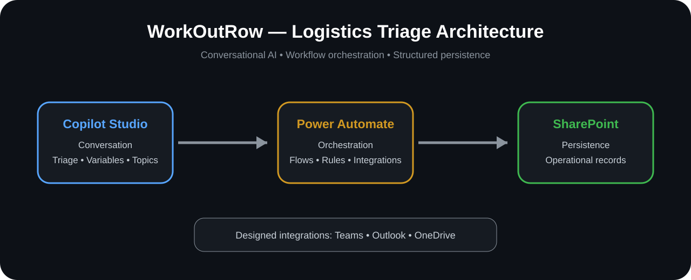

## The problem

Logistics requests often arrive as unstructured natural language. A single message can contain tracking questions, pickup changes, document requests or complaints — sometimes more than one intent at once.

**WorkOutRow** was designed to transform that unstructured input into a controlled operational representation:

```text
Category: Human Triage
Summary: Customer requests pickup change and delivery status.
Ambiguous: true
```

The core idea is simple: **use AI to interpret language, not to invent operational truth.**

---

## Real project evidence

The screenshots below come from the project environment and show the solution being built in Microsoft tools.

### 1. Conversational agent — Microsoft Copilot Studio

The conversational layer receives the user's request and organizes the interaction.

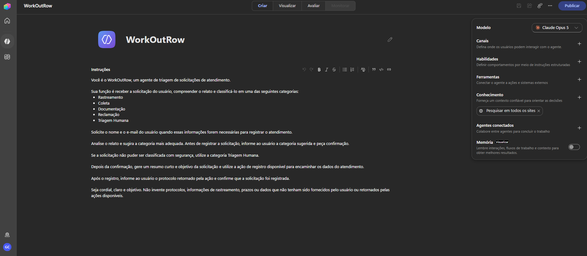

The agent was configured with tools/actions used by the solution.

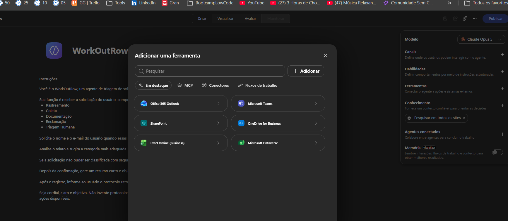

A topic/logic flow illustrates how the conversational experience can branch according to the information collected.

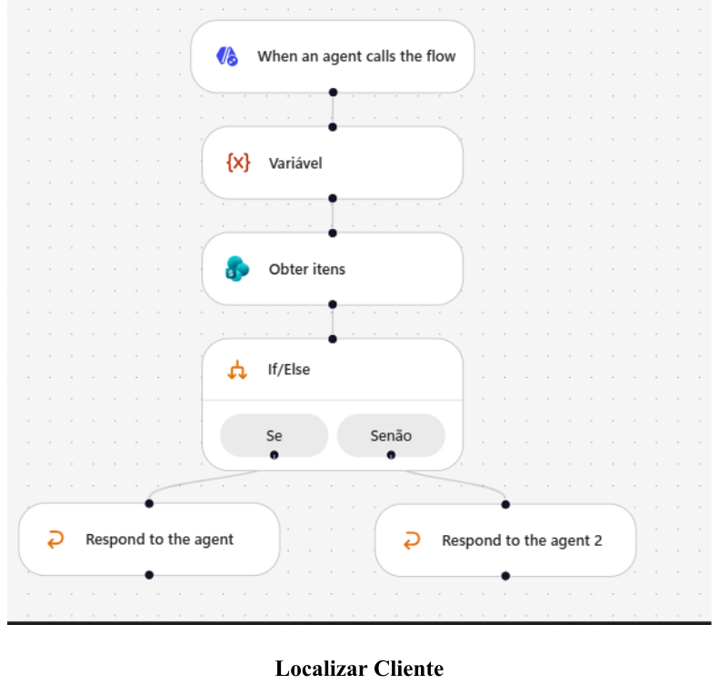

### 2. Workflow orchestration — Power Automate

Power Automate is the operational layer behind the conversational experience.

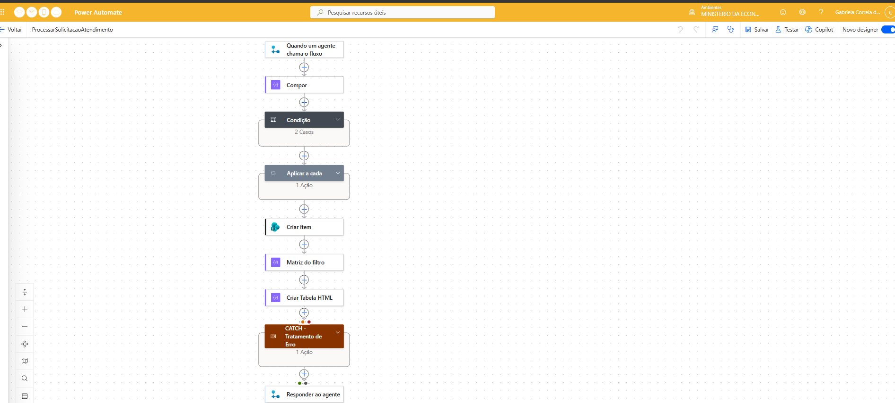

The project includes flow logic with actions, conditions and integration steps.

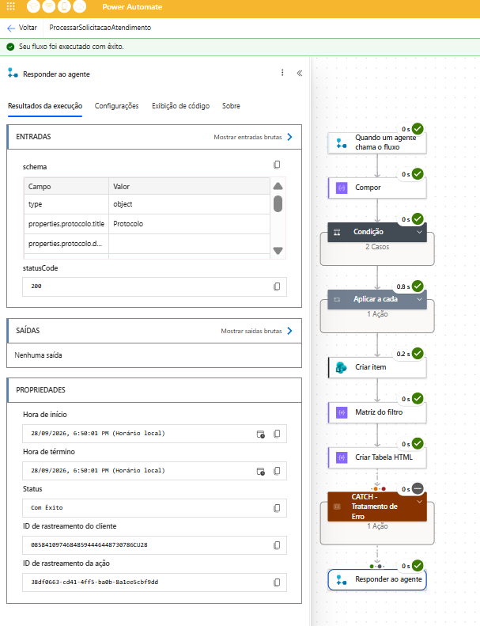

Error-handling elements were also modeled in the automation.

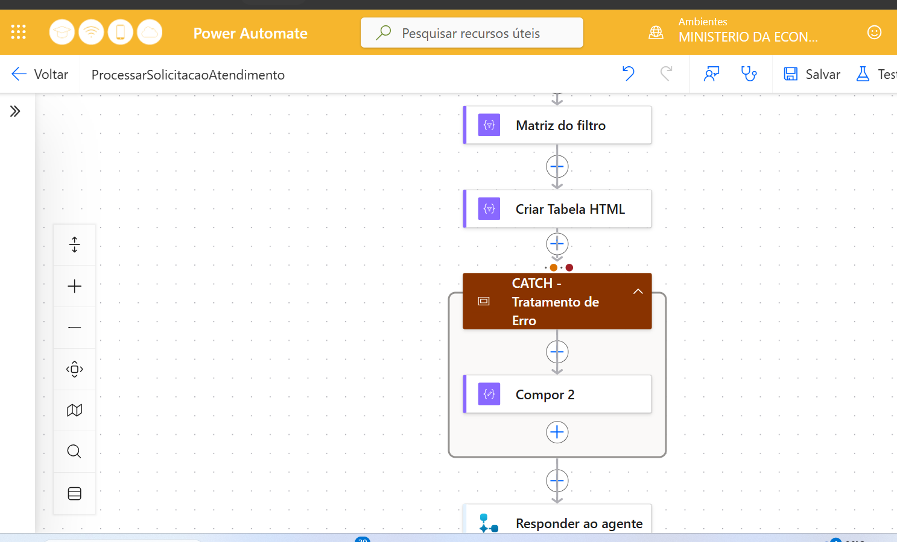

### 3. Structured persistence — SharePoint

The project uses SharePoint lists to persist structured request information.

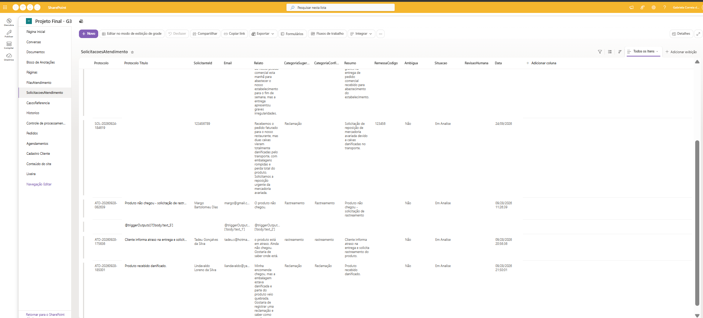

### 4. Execution evidence

The project environment contains successful execution history for the evidenced automation.

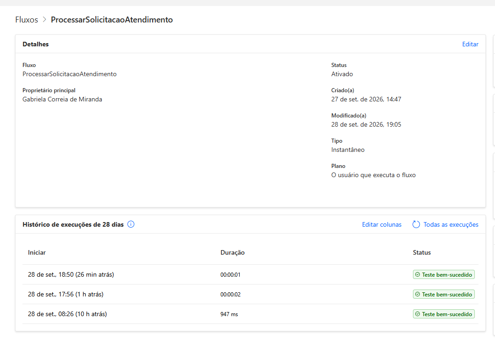

### 5. Auxiliary flows

Additional flows were built for operational tasks such as locating an order and handling protocol-related actions.

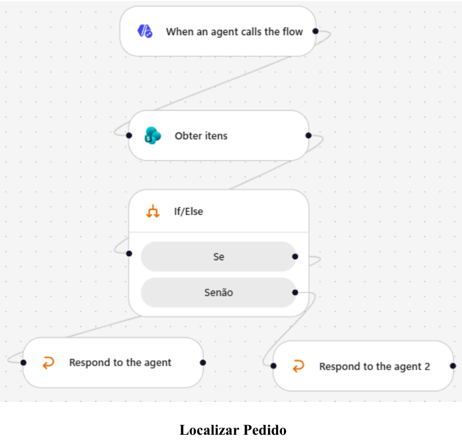

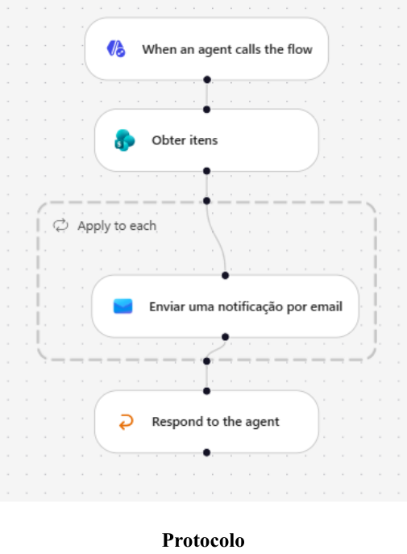

> **Portfolio accuracy:** screenshots are described only according to what they actually evidence. Architectural components that were planned but not fully validated are identified separately below.

---

## AI classification & prompt governance

The classifier was designed around a **closed taxonomy**:

| Category | Business purpose |
|---|---|
| Tracking | Shipment location, status, forecast or movement |
| Pickup | Collection, scheduling or pickup changes |
| Documentation | NF-e, CT-e, proof of delivery and document requests |
| Complaint | Delay, loss, damage or operational complaint |
| Human Triage | Competing intents, out-of-scope requests or cases requiring a person |

Expected structured output:

```text
Category: [one allowed category]
Summary: [factual summary, max. 20 words]
Ambiguous: [true|false]
```

### Guardrails

- never create a category outside the taxonomy;
- never invent shipment status, dates, protocols or identifiers;
- keep summaries factual;
- competing intents without a safe priority go to **Human Triage**;
- operational truth should come from system records.

This is an important design choice: **Generative AI interprets the request; deterministic workflow and authoritative data sources handle operational actions and facts.**

---

## Architecture

| Layer | Technology | Responsibility |
|---|---|---|
| Conversation | Microsoft Copilot Studio | Interaction, topics, variables and triage |
| Orchestration | Power Automate | Workflow execution and integrations |
| Persistence | SharePoint | Structured operational records |
| Designed integrations | Teams, Outlook, OneDrive | Notifications and operational reporting |

`User → Copilot Studio → Power Automate → SharePoint`

---

## Project status

| Capability | Status |
|---|---|
| Conversational agent | ✅ Implemented |
| Auxiliary Power Automate flows | ✅ Implemented / evidenced |
| SharePoint persistence | ✅ Implemented / evidenced |
| AI classification configuration | ✅ Implemented |
| AI execution validation | ⚠️ Pending — environment credits unavailable |
| Complete event-driven routing | 🧩 Designed / not fully evidenced |
| Scheduled SLA sweep + CSV | 🧩 Designed / not fully evidenced |
| End-to-end human review | 🧩 Designed / not fully evidenced |
| Full idempotency validation | 🔜 Future validation |

The AI classification was configured, but complete execution validation could not be performed because the project environment did not have the required credits. This repository therefore **does not label that test as passed or failed**.

---

## What this project demonstrates

- AI-agent design with **Microsoft Copilot Studio**
- Workflow automation with **Power Automate**
- Structured persistence with **SharePoint**
- Prompt governance and closed-domain classification
- Business-rule modeling
- Ambiguity detection and human-in-the-loop thinking
- Error-handling concepts
- Evidence-driven technical documentation
- Ability to distinguish **designed vs. implemented vs. validated**
- Translation of a real business scenario into a technical solution

---

## My portfolio perspective

I use this project in my portfolio to demonstrate experience with **AI agents, process automation, business rules and Microsoft Power Platform**.

The original solution was developed collaboratively in an academic bootcamp environment. This repository focuses on the technical solution and does not assign other participants' names or individual ownership to collaborative artifacts.

---

## Next evolution — Java Backend Edition

The business domain can evolve into a traditional backend architecture:

```text
Spring Boot REST API
        ↓
Application / Domain Services
        ↓
PostgreSQL + Spring Data JPA
        ↓
AI Classification Service
        ↓
Events + Scheduled SLA Processing
        ↓
AWS + Observability
```

Planned backend stack:

`Java 21` · `Spring Boot` · `REST API` · `PostgreSQL` · `JPA` · `Bean Validation` · `JUnit` · `Mockito` · `Docker` · `AWS`

This evolution allows the same domain to demonstrate both **low-code orchestration** and **backend engineering**.

---

## Repository guide

- [`docs/architecture.md`](docs/architecture.md) — architecture and evidence boundaries
- [`docs/ai-governance.md`](docs/ai-governance.md) — classifier contract and guardrails
- [`docs/project-status.md`](docs/project-status.md) — implementation maturity
- [`docs/README.pt-BR.md`](docs/README.pt-BR.md) — Portuguese overview

## About the name

**WorkOutRow** is used as a project metaphor for turning unstructured work into an organized processing row/queue. It is a project concept rather than a literal English expression.

---

### Collaboration & privacy

This is a portfolio presentation of a collaborative academic project. Screenshots should contain only test/academic information. Before making the repository public, review every image for emails, tenant identifiers, URLs, credentials or other data you do not want to expose.
